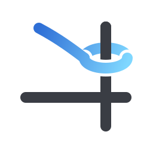

<p align="center">
  <picture>
    <source media="(prefers-color-scheme: dark)" srcset="assets/berthd-mark.svg">
    
  </picture>
</p>

# berthd — 閉じても消えないシェルセッション

[English](README.md)

`berthd` は **PTY を所有する小さなデーモン**です。シェルの寿命を端末アプリから切り離すので、
**アプリを閉じてもシェルは動き続け、あとで同じセッションへ scrollback ごと戻れます**。
セッションの永続化をするという意味では tmux と同じですが、ヘッドレスです。画面の描画はしません。
端末エミュレーションはクライアントが行いますので、好きな端末を使ってください。

**画面を持たないのは設計です。** 分割やタブ（多重化）は端末アプリの仕事で、berthd はやりません。
代わりに**セッションはいくつでも作れます** —— ペインを 2 つ開いて、それぞれで `berth attach a` /
`berth attach b` と打てば、どちらもその端末を閉じたあとも生き続けます。
画面を持たないので、**どの端末のどのペインの中にでも入れます**（tmux のペイン、端末アプリの
タブや分割、ssh の向こう）。

同梱の **`berth`** がセッションを操作する CLI です。どのシェルからでも使えます。

```
$ berth ls
* mywork  zsh   106x29  ~/src/app
  build   zsh   120x40  ~/src/lib
```

## Windows Terminal

`berthd` は **Windows でそのまま動きます**。WSL も Cygwin も要らず、入れるのは `.exe` 2 本だけです。
タブと分割は Windows Terminal が既に持っています。berthd が足すのは、Windows Terminal に無いもの
—— **窓より長生きするセッション**だけです。

- **いつものシェルで**: PowerShell（Windows PowerShell 5.1 / PowerShell 7）、`cmd`、そのほかのシェルも `berth attach -s <shell>` で。
- **窓を閉じてもシェルは残る**: タブやペイン、窓ごと閉じても、セッションは動き続けます。`berth attach <名前>` で戻れます。
- **履歴は Windows Terminal 自身のスクロールに戻る**: 入り直すと、これまでの出力が端末そのものへ描き直されます。
  マウスホイール・検索（`Ctrl+Shift+F`）・コピーがいつもどおり使えます。
- **タブがどこに居るかを名乗る**: attach している間、タブの題名は `berth: <名前>` で、その後ろに中で動いているものの題名が続きます。
- **ペインは 1 行で開ける**: [いつものペインを一度に開く](#いつものペインを一度に開く) を見てください。

## インストール

**Linux / macOS**

```sh
curl -fsSL https://raw.githubusercontent.com/takakix2/berthd/main/scripts/install.sh | sh
```

**Windows**（PowerShell）

```powershell
irm https://raw.githubusercontent.com/takakix2/berthd/main/scripts/install.ps1 | iex
```

⭐ **入れる前に用意する物はありません** —— Windows 10 以降には `curl` も `tar` も
標準で入っているので、展開ソフトも要りません。配布物は `.zip` なので、
エクスプローラーからダブルクリックで開くこともできます。
⚠️ **git-bash から `install.sh` を撃っても入りません** —— 面ごとに入口は 1 つで、
Windows は上の PowerShell の入口だけです。
⚠️ **ARM64 向けはまだ配っていません。** x64 版はエミュレーションで動きますが
その分遅くなるので、installer は黙って入れずに断ります。押し切るなら、引数を渡せるこちらの形で入れてください:

```powershell
& ([scriptblock]::Create((irm https://raw.githubusercontent.com/takakix2/berthd/main/scripts/install.ps1))) -Target windows-x86_64
```

⭐ **常駐させるなら** —— Windows には `systemd` も `launchd` も無いので、**タスクスケジューラのログオントリガ**を使います（管理者権限不要）。
手順は [dist/README.md](dist/README.md) に在ります。

🚨 **`berth attach` の中から入れ直すとき**は、使用中の `.exe` を退かしてから置きます。
退かした `*.exe.old` はそのプロセスが終わるまで消せないので、**次に install したときに自動で掃きます**。

インストーラーは次のことをします。

- 最新のリリースをダウンロードし、`SHA256SUMS` で検算する
- `berthd` と `berth` を `~/.local/bin` にインストールする（`BERTHD_INSTALL_DIR` で変更できます）
- インストールの前に**`berth kill-server`** でデーモンを停止してください。セッションが残っている場合はインストールを中断します。

手動でインストールする場合:

```sh
curl -fsSL https://github.com/takakix2/berthd/releases/latest/download/berthd-linux-x86_64.tar.gz | tar xz
cd berthd-*/ && install -m755 berthd berth ~/.local/bin/
```

Windows で手で入れる場合（同じく標準の道具だけで済みます）:

```powershell
curl.exe -fsSL -o berthd.zip https://github.com/takakix2/berthd/releases/latest/download/berthd-windows-x86_64.zip
tar.exe -xf berthd.zip
Move-Item berthd-*\berth*.exe $env:USERPROFILE\.local\bin\ -Force
```

- 配布しているのは **Linux x86_64** と **macOS arm64**（`berthd-macos-arm64.tar.gz`）です。
- 展開先はディレクトリです（カレントに `berthd` は出来ません）。
- **`berth` と `berthd` の版が違うと動かない場合があります。** うまく動かないときは `berth info` で両方の版を確かめてください。

## 使い方

```sh
berth attach work     # セッション work に入る（無ければ作る。berthd も居なければ起こす）
# … 作業 …
berth d               # セッションから抜ける（シェルは berthd の下で動き続ける）
berth attach work     # 同じシェルに戻る
```

| コマンド                                   |                                                                                             |
| ------------------------------------------ | ------------------------------------------------------------------------------------------- |
| `berth attach [<name>]`（`a`）             | このターミナルでセッションに入る（無ければ作る）                                            |
| `berth attach -s <shell> [<name>]`         | **指定したシェル**でセッションを作る（無ければ作る。`-s` / `--shell`）                      |
| `berth attach -r <name>`                   | **見るだけ**で入る（打鍵も画面の大きさも送らない。`q` か Ctrl-C で抜ける）                  |
| `berth attach --no-scrollback [<name>]`    | **最後の画面だけ**戻す（既定は、これまでの出力をこの端末のスクロールに流してから戻る。下記） |
| `berth detach [<name>]`（`d`）             | セッションから抜ける（省略時は今いるセッション。見ている端末も含めて全員が抜ける）          |
| `berth ls`                                 | 一覧（`*` が今いるセッション）                                                              |
| `berth rename [<session>] <name>`（`r`）   | 名前を付け直す（省略時は今いるセッション）                                                  |
| `berth kill <session>`                     | セッションを閉じる（中のシェルごと）                                                        |
| `berth info`                               | 接続先の berthd（ホストと版）と、**この端末で新しいセッションを作ったら起きるシェル**を表示 |
| `berth kill-server [-f]`                   | berthd を停止する（セッションが残っていれば `-f` が要る）                                   |
| `berth --version` / `berthd --version`     | 版を表示（デーモンには接続しません）                                                        |

`<name>` には名前（`main` など）か id を渡せます。セッションの中では `BERTHD_SESSION` に自分の
session id が入っているので、`berth ls` の `*` や、引数 1 つの `berth rename <name>` が効きます。

### 入り直すと、これまでの出力が端末のスクロールで辿れる（既定）

`berth attach` で戻ると、そのセッションがこれまでに出した出力（直近 512KB ぶん）を**この端末自身の
スクロールバック**に流してから、今の画面を描き直します。tmux のように別の画面に閉じ込めないので、
ホイールや端末の検索・コピーがいつもどおり効きます。全画面アプリ（vim など）の中に居たまま戻った
ときは履歴を流さず、今の画面だけを描きます。

- **最後の画面だけでよい**（今までの形）: `berth attach --no-scrollback <name>`
- **ずっと外す**: `BERTH_SCROLLBACK=off`
- **自動で外れる**: tmux / zellij / screen の中（外側が既にスクロールを持っている）と、出力が端末でないとき。
  中で試したいときは `--scrollback` で押し切れます。
- **同じペインで入り直すと続きだけ流します**: ペインごとに安定した ID を出す端末（Windows Terminal・WezTerm・kitty・iTerm2・Apple Terminal・Alacritty）では、`berth` がどこまで見せたかを覚えていて新しい分だけ流すので、同じ履歴が二重に積まれません。ID を出さない端末では、毎回 512 KB をまるごと流す今までの形に落ちます。
- **新しく作る**ときは窓を上端から使います: `berth attach` を打った行はスクロールへ上がり（tmux が画面を取るのと同じ動き）、シェルは 1 行目から始まります。生きているときと入り直したときの画面を同じ形に保つためです。
- 録画が上限（512KB）を越えると古い出力から**行の切れ目で**捨てられ、その時点で効いていた色・全画面の状態・題名は再生に引き継がれます。再生の 1 行目が命令の尻尾や文字の半分から始まることはありません。

### シェルを指定してセッションを作る（`-s` / `--shell`）

新しいセッションを作るとき、起動するシェルをアドホックに指定できます。
`-s <shell>`、`--shell <shell>`、`--shell=<shell>` が使えます。

```sh
berth attach -s /bin/bash debug      # このセッションだけ bash で起動する
berth attach -s hsh work             # hsh で新しいセッションを作る
berth attach -s powershell.exe win   # Windows でシェルを指定する
```

- **新規作成時（セッションが存在しないとき）のみ有効です。** すでに動いている既存セッションに attach する場合は、そのセッションで動いているシェルにそのまま接続します（後からシェルをすり替えることはしません）。
- **すべての面（Linux / macOS / Windows）で効きます。** 環境変数（`BERTHD_SHELL`）や親プロセスの自動観測よりも最優先（出所: `client:cli_flag`）で解決されます。
- `-r`（read-only）と組み合わせることもできます（例: `berth attach -s /bin/bash -r monitor`）。

### 複数の端末から同じセッションに入る

- **キーを打てるのは常に 1 台です。** 別の端末から `berth attach` で同じセッションに入ると、前の端末は
  `[detached from …]` と表示して抜けます（シェルはそのまま動き続けます）。前の端末の打鍵が
  混ざることはありません。
- **read-only のオプションがあります**（`berth attach -r`）。見るだけなら何台でも入れます。
  read-only では画面の大きさを変えません。画面の大きさはキーを打っている端末が決めるので、read-onlyの端末の画面が
  それより小さいと、全画面のアプリ（`vim` や `htop`）の表示では画面の表示が崩れます。
- 見る側が出力に追いつけないときは、**その見る側だけ**が外れます（打っている側は止まりません）。
- `-r` は berthd 0.3.0 以降が必要です。古い berthd に対しては `berth` が断ります
  （`berth kill-server` で入れ替えてください）。

### いつものペインを一度に開く

berthd は、もともと iOS / デスクトップの端末アプリ argotty の
**停泊所**として作りました。ところが画面を持たないので、**どの端末が来ても迎え入れられました** ——
並べ方は端末に任せ、berthd はセッションの寿命だけを持ちます。

`berth attach <name>` は**無ければ作り、あれば繋ぐ**ので、レイアウトを開くスクリプトは
**初回も 2 回目も同じ 1 本**で済みます。朝に叩けばセッションが生まれ、端末を閉じたあとにもう一度
叩けば同じシェルへ戻ります。

**Windows Terminal**（PowerShell から）:

```powershell
wt new-tab --title dev berth attach dev `; split-pane -V berth attach build `; split-pane -H berth attach logs
```

⚠️ PowerShell では `;` が自分の区切りとして食われるので、`wt` へ渡すには `` `; `` と書きます
（cmd からなら素の `;` で通ります）。

**WezTerm**（WezTerm の中のシェルから）:

```sh
wezterm cli spawn -- berth attach dev
wezterm cli split-pane --right -- berth attach build
```

同じセッションは、別の端末や ssh の向こうからでも `berth attach build` で入れます。

### デーモンの寿命

- berthd は**自分からは終了しません**（アイドルタイムアウトはありません）。停止させるのは `berth kill-server` です。
- berthd を**常駐させたい**ときは、systemd / launchd の設定が [dist/README.md](dist/README.md) にあります。

### 環境変数

| 変数                  | 効果                                                                                                                                                                                                             |
| --------------------- | ---------------------------------------------------------------------------------------------------------------------------------------------------------------------------------------------------------------- |
| `BERTHD_SOCKET`       | ソケットの場所（既定は `$XDG_RUNTIME_DIR/berthd.sock`、無ければ `~/.berth/berthd.sock`）。**明示すると `berth attach` は berthd を起こしません**（転送したソケットなど、別の接続先を指している可能性があるため） |
| `BERTHD_NO_SPAWN`     | 立てると `berth attach` が berthd を起こさなくなる。常駐させている環境で二重起動を防ぐ                                                                                                                           |
| `BERTHD_NO_SCOPE`     | Linux で、`berth attach` が起こす berthd を**自分の systemd スコープに入れない**。既定では `systemd-run --user --scope` で別スコープに出すので、端末（のスコープ）がメモリ不足で止められても berthd とセッションは残ります（ユーザーの systemd が無い・`systemd-run` が無いときは自動でこれまでどおり） |
| `BERTHD_BIN`          | `berth attach` が起こす berthd の場所（既定は `berth` の隣、次に `PATH`）                                                                                                                                        |
| `BERTHD_SHELL`        | セッションで使うシェル（下記の「セッションのシェルはどう決まるか」）。`berth` を打った環境と berthd 自身の環境の**どちらでも**効きます（前者が先）                                                                                     |
| `BERTHD_JOURNAL_PATH` | journal の場所（既定 `~/.berth/journal.jsonl`）                                                                                                                                                                  |
| `BERTHD_SESSION`      | **berthd が子プロセスに渡す**自分の session id（上記）                                                                                                                                                           |
| `BERTH_SCROLLBACK`    | `off`（`0` / `no` / `false` も可）で、`berth attach` が出力を端末のスクロールに流すのをやめる（`--no-scrollback` をずっと付けた形）                                                                                   |
| `AUDIT_ACTOR`         | `berth` が attach のときに名乗る名前（journal の `actor`）。管理者が付ける想定です                                                                                                                       |

## セッションのシェルはどう決まるか

`berth attach <名前>` で新しいセッションを作るとき、シェルは次の順で決まります。

| 順  | 何を見るか                                                                                       | 出所の呼び名          |
| --- | ------------------------------------------------------------------------------------------------ | --------------------- |
| 1   | `--shell <path>` / `-s <path>`（CLI 引数・最優先・**面に依らない**）                              | `client:cli_flag`     |
| 2   | `BERTHD_SHELL`（`berth` を打った環境・**面に依らない**）                                         | `client:berthd_shell` |
| 3   | `~/.berth/config.toml` の `default-shell`（[設定ファイル](#設定ファイル)・**面に依らない**）       | `client:config`       |
| 4   | **そのとき走っていたシェル**（`berth` の親プロセス。`/etc/shells` に載っているシェルだけ・unix のみ）| `client:parent_shell` |
| 5   | `$SHELL`（同じく `berth` を打った環境・unix のみ）                                               | `client:env_shell`    |
| 6   | 上のどれも無ければ berthd 側の既定（`BERTHD_SHELL` → `$SHELL` → `/etc/passwd` のログインシェル → `/bin/bash` か `/bin/sh` の在る方 / `powershell.exe`） | `daemon:…`            |

`berth info` がこの端末の答えを表示します。同じ呼び名が journal にも `shell_src` として残ります。

**4 番目が要る理由**: `bash` から `fish` と打って fish に居るとき、`$SHELL` は `/bin/bash` のままです
（`$SHELL` は「ログインシェルに何を選んだか」の申告値で、いま走っているシェルではありません）。
そのため、**いま使っているシェルがそのままセッションのシェルになります**。

**Windows では 4 と 5 は効きません**（`/etc/shells` が無く、git-bash の `$SHELL` は
`/bin/bash.exe` という MSYS の綴りで、Windows のプロセス起動からは解決できないため）。
切り替えは `-s / --shell` オプション・`BERTHD_SHELL`・設定ファイルの `default-shell` を使ってください。

**0.3.x まではデーモンの環境だけで決まっていました。** `berth` はデーモンが居なければ自分で
起こすので、最初に起こした端末の環境がデーモンに焼き付き、以後どの端末から attach しても
そのシェルが出ていました（tmux のペインで 1 度打つと、そのデーモンは終わるまで tmux の
`default-shell` を配り続ける、という形で出ます）。

## 設定ファイル

`berth` は `~/.berth/config.toml` を読みます（journal・ペインファイルと同じ場所。どの OS でも同じ）。別のファイルを読ませるには `BERTH_CONFIG=<path>`。無くても動きます。

```toml
# 新しいセッションのシェル（毎回 `berth attach -s hsh` と打つのと同じ）
default-shell = "hsh"

# 新しく作るセッションにだけ足す環境変数
[env]
CLAUDE_CODE_SHELL = "~/.local/libexec/hsh-as-bash/bash"
```

- `default-shell` は `-s` と `BERTHD_SHELL` に負け、観測したシェルに勝ちます（[セッションのシェルはどう決まるか](#セッションのシェルはどう決まるか)）。journal には `client:config` と残ります。
- `[env]` は**セッションを作るときだけ**効きます。既存のセッションに入り直しても足しません。値の先頭の `~` / `~/` はホームに展開します。`$VAR` は展開しません。
- 読めないファイル（TOML の誤り・知らないキー・型違い）は**黙って無視しません**。`berth` が 1 行名乗って、設定が無いものとして続けます。`berth info` に場所と読めたかが出ます。

**`[env]` が要る理由**: Claude Code のようなエージェントは、命令ごとに自分のシェルを起こします。どのシェルかは環境変数（`CLAUDE_CODE_SHELL`）で決まり、セッションのシェルは使いません。上の例のように書いておくと、`berth` のセッションの中で `claude` を起こしたときエージェントの命令も `hsh` の上で走り、ログインシェルを変えずに `hsh` の journal にエージェントの記録が残ります。

---

## Journal

berthd は **セッションを起こしたこと**と **attach の開始・終了**を `~/.berth/journal.jsonl` に
NDJSON（[Rheon Protocol](https://github.com/rheon-protocol/spec) v1 レコード）で残します。1 行に**観測した事実と、クライアントの自己申告**の両方が
載ります。設定は要りません。

| 行                            | いつ                     | 何が読めるか                                                                      |
| ----------------------------- | ------------------------ | --------------------------------------------------------------------------------- |
| `spawn:started`               | セッションを起こしたとき | どのシェルで起こしたか（`shell`）と、**それを誰が決めたか**（`shell_src`）、`cwd` |
| `spawn:failed`                | シェルを起こせなかったとき | 何を起こそうとしたか（`shell` / `shell_src`）と、**なぜ駄目だったか**（`reason`・1 行） |
| `attach:start` / `attach:end` | 誰かが入った / 出たとき  | 誰が入ったか、どのくらい居たか、どう抜けたか                                      |

`spawn:started` が別の行なのは、**一覧が「今」しか答えられない**からです ——
セッションが消えると、それがどのシェルだったかはどこにも残りませんでした。

| 欄                                    | 何か                                                                                                                                                                                      | 出所                                   |
| ------------------------------------- | ----------------------------------------------------------------------------------------------------------------------------------------------------------------------------------------- | -------------------------------------- |
| `peer_uid` / `peer_pid`               | 接続してきたプロセス                                                                                                                                                                      | カーネルが観測した値                   |
| `peer_auid`                           | ログインしたときのユーザーの監査 uid（`su` や `sudo` をまたいでも変わらない）                                                                                                             | カーネルが観測した値（Linux / macOS）  |
| `peer_ancestry` / `peer_ancestry_src` | attach した瞬間の、接続してきたプロセスの親の並び（最大 8 段）と、どこまで読めたか                                                                                                        | カーネルが観測した値                   |
| `actor` / `actor_src`                 | クライアントが名乗った名前と、その出所                                                                                                                                                    | クライアントの自己申告（検証しません） |
| `shell` / `shell_src`（起こした行）   | 実際に起こした実行ファイルと、**それを誰が決めたか**（下記）                                                                                                                              | berthd                                 |
| `read_only`                           | 見るだけの接続か                                                                                                                                                                          | berthd                                 |
| `how`（終了の行）                     | `exited`（シェルが終了した）／ `detached`（外された。別の端末が入って置き換えられた場合も含む）／ `closed`（自分で抜けた・接続が閉じた）／ `too_slow`（見る側が出力に追いつけず外された） | berthd                                 |

観測だけでは足りないのは、**人も AI エージェントも同じユーザーの uid で動く**からです。
自己申告だけでも足りません（誰でも名乗れます）。並べておけば、一致していれば問題なし、
食い違っていれば調べる、が 1 行で読めます。名乗らなかった attach の欄は空のままにします
（「誰も名乗らなかった」も事実なので、OS のユーザー名で埋めません）。

`berth` の名乗りは、**`berth attach` を打った環境**の変数から拾います（空の値は名乗りとして扱いません）。

1. **`AUDIT_ACTOR`** —— 名乗らせたいときはこれを設定します（`actor_src` は `audit_actor`）
2. AI エージェントが自分で置く汎用の印 —— `AI_AGENT`（`agent`）。ベンダ固有の印は読みません。
   **設定しなくても付きます**

設定はシェルを選びません（bash / zsh は `export AUDIT_ACTOR=…`、fish は `set -gx AUDIT_ACTOR …`。
常駐させているなら unit の `Environment=`）。効くのは **`berth attach` を打つ環境**です ——
セッションの中で設定しても、その attach の記録には載りません。

`actor` / `actor_src` だけが**裏の取れない値**です（クライアントが名乗ったまま記録します）。
`peer_` が付く欄はカーネルに訊いた観測値で、名乗りとは別の出所です。

### どの道具が attach したのかを知りたいとき

🚫 **`actor` を見ないでください** —— あれは「集計するために**誰かが選んだ名前**」で、
誰も選ばなければ空のままです。▶ **`peer_ancestry` を読んでください**。

berthd は親プロセスの名前を `actor` に入れません。直の親はたいていシェルや端末
（`bash`・`WindowsTerminal.exe`・`pwsh.exe` など）で、attach した道具はその**もう少し奥**に出ます。
並び全体を見てください。

⚠️ 突き合わせるときは、**末尾の `.exe` を大小を無視して落として**から比べてください
（同じ道具が `claude` と `claude.exe` の 2 通りで載ることがあります）。

親の並びは `sshd` などで止めずに辿るので、ssh 越しの attach でも「何から起動されたか」が残ります。

berthd はシェルの中で打たれたコマンドを記録しません（流れるバイト列を解釈しない設計です）。
コマンドの記録はシェル側の仕事で、シェルが `BERTHD_SESSION` を自分の記録に残せば
（例: hsh の `session:start`）、berthd の journal とシェル側の記録を session id で突き合わせられます。
session id が示すのは「そのセッションの子孫である」ことなので、時刻は attach レコードの
開始・終了で絞ってください。

### 権限

ソケットは `0600`、`~/.berth` は `0700`、journal は `0600` で berthd 自身が作ります（起動元の umask に
依存しません）。macOS には `XDG_RUNTIME_DIR` が無く、ソケットは `~/.berth` に置かれるため、
この締め付けがそのまま防御になります。

Windows の名前付きパイプ（`\\.\pipe\berthd-<user>`）には所有者だけの DACL が付き、`berth` は繋いだ先の
プロセスが自分のアカウントの物かを握手の前に確かめます（他のユーザーに取られていれば、相手を名指しして断ります）。
同じアカウントで走る別のプロセスからは守りません。

## 旧 `argod` / `argo` から乗り換える

v0.2.0 でデーモンは **`berthd`**、CLI は **`berth`** になりました。`argo` という名前は
[Argo Workflows](https://argoproj.io) の CLI と重なり、どちらにも `list` があるため、両方入っている
環境ではエラーにならずに**違う方の空の一覧**が返ります。この衝突を残さないため、`argo` の互換名は
用意していません。

```sh
argo attach build      # 旧
berth attach build     # 新
```

- インストーラーは旧名のバイナリを消します。常駐させていた場合は unit / plist も入れ替えてください
  （[dist/README.md](dist/README.md)）。
- 環境変数は `ARGOD_*` → `BERTHD_*` です。
- journal が `~/.argo/journal.jsonl` に残っていれば、手で `~/.berth/journal.jsonl` へ移してください。
- `~/.argo/config.toml` は berthd の設定ではないので、そのままで構いません。

## ライセンス

ISC（[LICENSE](LICENSE)）。同梱しているサードパーティの表示は [THIRD-PARTY-NOTICES.md](THIRD-PARTY-NOTICES.md) にあります。
