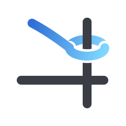

<p align="center">
  <picture>
    <source media="(prefers-color-scheme: dark)" srcset="assets/berthd-mark.svg">
    
  </picture>
</p>

# berthd — Shell sessions that survive closures

[日本語](README.ja.md)

**Close the window. The shell keeps running.**

`berthd` is a lightweight, headless daemon that manages and persists pseudoterminals (PTYs). By decoupling the shell's process lifecycle from the terminal emulator, sessions remain persistent across client disconnects. While achieving session persistence similar to `tmux`, `berthd` adopts a headless design—leaving pane splitting, tabs, and all UI rendering to your native terminal emulator. It operates seamlessly across any terminal (Windows Terminal, Ghostty, Alacritty, etc.), inside tmux panes or splits, and over SSH.

The package installs two binaries: the daemon `berthd` and the CLI client `berth` (cross-platform support for Windows, Linux, and macOS).

**`berth`** is the CLI used to manage and attach to sessions.

```bash
$ berth ls
* claude  pwsh  120x40  C:\src\app
  build   pwsh  120x40  C:\src\lib
```

---

## Installation

The installer downloads the latest release binary, verifies the checksum against `SHA256SUMS`, and installs `berthd` and `berth` to `~/.local/bin` (configurable via `BERTHD_INSTALL_DIR`).

When updating or reinstalling, stop the daemon first using `berth kill-server` (the update aborts if active sessions are running).

### Windows

Run in PowerShell:

```powershell
irm https://raw.githubusercontent.com/takakix2/berthd/main/scripts/install.ps1 | iex
```

- Distributed as a `.zip` archive. Can also be extracted and installed manually via File Explorer.
- **Windows ARM64 binaries are currently not provided.** To install the x64 binary under emulation, specify `-Target windows-x86_64`:
  ```powershell
  & ([scriptblock]::Create((irm https://raw.githubusercontent.com/takakix2/berthd/main/scripts/install.ps1))) -Target windows-x86_64
  ```
- To run the daemon persistently as a service across logons, use Task Scheduler with a logon trigger (no administrator rights required). See [dist/README.md](dist/README.md).
- When reinstalling from inside an active `berth attach` session, the installer temporarily renames the in-use binaries (the renamed `*.exe.old` files are automatically cleaned up during the next installation after process termination).

Manual installation steps:

```powershell
curl.exe -fsSL -o berthd.zip https://github.com/takakix2/berthd/releases/latest/download/berthd-windows-x86_64.zip
tar.exe -xf berthd.zip
Move-Item berthd-*\berth*.exe $env:USERPROFILE\.local\bin\ -Force
```

### Linux

```bash
curl -fsSL https://raw.githubusercontent.com/takakix2/berthd/main/scripts/install.sh | sh
```

- Target architecture: x86_64
- For persistent daemon operation (systemd user service), see [dist/README.md](dist/README.md).

Manual installation steps:

```bash
curl -fsSL https://github.com/takakix2/berthd/releases/latest/download/berthd-linux-x86_64.tar.gz | tar xz
cd berthd-*/ && install -m755 berthd berth ~/.local/bin/
```

### macOS

```bash
curl -fsSL https://raw.githubusercontent.com/takakix2/berthd/main/scripts/install.sh | sh
```

- Target architecture: Apple Silicon (arm64)
- For persistent daemon operation (launchd LaunchAgent), see [dist/README.md](dist/README.md).

Manual installation steps:

```bash
curl -fsSL https://github.com/takakix2/berthd/releases/latest/download/berthd-macos-arm64.tar.gz | tar xz
cd berthd-*/ && install -m755 berthd berth ~/.local/bin/
```

### Version Compatibility

Mismatched versions between the client (`berth`) and daemon (`berthd`) may lead to protocol inconsistencies. If unexpected behavior occurs, verify both versions using `berth info`.

---

## Usage

```bash
berth attach work     # Attach to session 'work' (creates if missing, auto-spawns daemon if not running)
# … work …
berth d               # Detach from session (shell continues running in the background)
berth attach work     # Reattach to the same session
```

---

## Commands

| Command | Description |
| :--- | :--- |
| `berth attach [<name>]` (`a`) | Attach to a session in the current terminal (creates new session if not present) |
| `berth attach -s <shell> [<name>]` | Create and attach to a new session with a specified shell (`-s` / `--shell`) |
| `berth attach -r <name>` | Attach in read-only mode (keystrokes and resize disabled; exit with `q` or `Ctrl-C`) |
| `berth attach --no-scrollback [<name>]` | Skip scrollback replay and restore only the current screen state (see below) |
| `berth detach [<name>]` (`d`) | Detach from session (defaults to current session; disconnects all attached clients) |
| `berth ls` | List active sessions (`*` marks the current session) |
| `berth rename [<session>] <name>` (`r`) | Rename a session (defaults to current session) |
| `berth send <session> [<text>...]` | Type into a session without attaching (appends Enter; see below) |
| `berth peek <session> [--lines N] [--json]` | Show a session's recent screen as plain text, with idle time (see below) |
| `berth kill <session>` | Terminate a session (including child shell processes) |
| `berth info` | Display daemon connection info (host & version) and the resolved shell for new sessions |
| `berth kill-server [-f]` | Stop the `berthd` daemon (requires `-f` if active sessions remain) |
| `berth --version` / `berthd --version` | Display version information (does not connect to daemon) |

`<name>` accepts a session name (e.g. `main`) or a session ID. Inside a session, the environment variable `BERTHD_SESSION` holds the current session ID, enabling context-aware commands like `berth ls` (the `*` indicator) and parameter-free `berth rename <name>` or `berth detach`.

### Scrollback Buffer Replay on Reattach (Default)

When reattaching via `berth attach`, the session's recent output history (up to 512 KB) is replayed directly into the terminal emulator's native scrollback buffer before redrawing the current screen. Because output is not trapped inside an alternate screen or virtual terminal multiplexer, native mouse-wheel scrolling, text selection, copy, and search functions remain fully available. If reattaching while a full-screen alternate-screen application (such as `vim`) is running, history replay is skipped and only the current screen is redrawn.

- **Restore current screen only**: `berth attach --no-scrollback <name>`
- **Disable scrollback replay globally**: `BERTH_SCROLLBACK=off`
- **Differential scrollback replay**: On terminal emulators that provide stable pane identifiers (Windows Terminal, WezTerm, kitty, iTerm2, Apple Terminal, Alacritty), `berth` tracks displayed output and replays only unseen differential history upon reattach to the same pane, preventing duplicate lines. Terminals without stable pane identifiers replay the entire 512 KB buffer.

### Specifying the Shell for New Sessions (`-s` / `--shell`)

When creating a new session, the shell executable can be explicitly specified using `-s <shell>`, `--shell <shell>`, or `--shell=<shell>`:

```bash
berth attach -s /bin/bash debug      # Launch this session specifically with bash
berth attach -s hsh work             # Create a new session with hsh
berth attach -s powershell.exe win   # Specify a shell on Windows
```

- **Applies to new sessions only**: When attaching to an existing session, the client connects to the currently running shell process (dynamic shell replacement is not performed).
- **Cross-platform**: Takes highest precedence across all supported operating systems over `BERTHD_SHELL` and parent process detection (source tag: `client:cli_flag`).
- Can be combined with `-r` (read-only mode), e.g., `berth attach -s /bin/bash -r monitor`.

### Multi-Client Connections

- **Exclusive control for interactive client**: Only one client may send keyboard input (write) to a session at any given time. If another client connects via `berth attach`, the preceding interactive client is automatically detached (displaying `[detached from …]`), preventing input collision and corruption while the underlying shell continues uninterrupted.
- **Concurrent read-only clients**: Multiple viewers may attach simultaneously using `-r`. Because terminal window dimensions follow the active interactive client, full-screen applications may appear misaligned if a viewer terminal is smaller than the primary client.
- **Automatic drop for lagging viewers**: If a read-only client's buffer fills due to rendering latency, only the lagging viewer is dropped, ensuring the primary interactive client is never blocked.

### Sending Input and Peeking Without Attaching (`send` / `peek`)

Scripts and monitoring agents can drive a session from outside without taking it over. Neither command attaches, so an interactive client that is already attached stays attached.

```bash
berth send work 'make test'          # types "make test" and presses Enter
berth send work --no-enter y         # types "y" without Enter
berth send work --ctrl-c             # sends Ctrl-C (0x03)
echo 'git status' | berth send work --stdin
berth peek work                      # last 30 lines of the screen, as plain text
berth peek work --lines 5 --json     # structured output for scripts
```

- **`send`**: Text arguments are joined with spaces and followed by Enter (`\r`) unless `--no-enter` is given. With `--stdin`, one trailing newline from standard input is dropped so the command does not run twice. Use `--` before text that starts with `-`.
- **Loop guard**: If a session produces no output at all between sends, `berthd` refuses the 6th consecutive send with `send_loop_limit`. This stops a runaway script from typing into a session that is not responding. `--force` skips the check.
- **`peek`**: Renders the session's recent output (up to 128 KB) through a terminal emulator and prints it without colors or escape sequences, with soft-wrapped lines rejoined. `--json` prints `session_id`, `name`, `cols`, `rows`, `idle_ms` (milliseconds since the session last produced output), `attached`, `in_alt_screen`, `program_status` and `lines`.
- **Program status (OSC 7501)**: Coding agents such as Claude Code and Antigravity report their state with `ESC ] 7501 ; state=… ST`, but only after the terminal answers their `ESC ] 7501 ; ?` probe, and most terminals do not answer it. `berthd` answers that probe itself (and does not forward it to the terminal), so agents report their state under any terminal, even while nobody is attached. `berthd` keeps the last report: `peek --json` prints it as `program_status` (`state`, `kind`, `app`, `msg`, and `age_ms`, the time since the agent entered that state), and `berth ls` adds it to the line, for example `[blocked:permission 3m]`. `null` means the program has not reported a state; it does not mean the program is idle. This probe is the only terminal query `berthd` answers. Device attributes, cursor position, colors and other queries are still left to the terminal.
- **Version**: Both commands need a `berthd` that speaks protocol 14 or later. `program_status` needs protocol 15; an older `berthd` simply omits it. Against an older daemon they exit with an error instead of waiting for a reply that will not come.

---

## Restoring Terminal Layouts

Because `berth attach <name>` transparently handles both session creation and reconnection, terminal layout automation scripts can be reused identically for both initial startup and session resumption:

**Windows Terminal (from PowerShell):**

```powershell
wt new-tab --title dev berth attach dev `; split-pane -V berth attach build `; split-pane -H berth attach logs
```

*Note: In PowerShell, the semicolon is a command separator; escape it with a backtick (``` `; ```) when passing arguments to `wt` (escaping is not required from `cmd.exe`).*

**WezTerm (from a shell within WezTerm):**

```bash
wezterm cli spawn -- berth attach dev
wezterm cli split-pane --right -- berth attach build
```

The resulting sessions can also be attached independently from separate terminals or over SSH using `berth attach build`.

---

## Environment Variables

| Variable | Description |
| :--- | :--- |
| `BERTHD_SOCKET` | Path to the UNIX domain socket (default: `$XDG_RUNTIME_DIR/berthd.sock`, falling back to `~/.berth/berthd.sock`). **When explicitly specified, `berth attach` will not auto-spawn a daemon** (to accommodate forwarded or remote sockets). |
| `BERTHD_NO_SPAWN` | When set to `1`, disables on-demand daemon spawning by `berth attach`. Recommended for persistent service deployments to prevent duplicate instances during transient restarts. |
| `BERTHD_SHELL` | Shell executable to spawn for new sessions (see "Shell Resolution Order" below). Recognized in both client and daemon environments, with client-side setting taking precedence. |
| `BERTHD_JOURNAL_PATH` | Path to the audit journal file (default: `~/.berth/journal.jsonl`). |
| `BERTHD_SESSION` | Session ID injected into child shell processes by `berthd`. |
| `BERTHD_NO_SESSION_SCOPE` | Linux only. By default each session's shell is moved into its own transient systemd scope (`berthd-session-<pid>-<n>.scope`), so that when systemd-oomd stops a session for memory pressure it stops that session alone, not `berthd` and every other session. Set to `1` to keep sessions in `berthd`'s own cgroup. Without a systemd user manager, sessions stay there automatically. |
| `BERTH_SCROLLBACK` | Set to `off` (`0`, `no`, or `false`) to disable scrollback replay upon attach (equivalent to always passing `--no-scrollback`). |
| `AUDIT_ACTOR` | Actor identity claimed by `berth` on attach (recorded in the journal's `actor` field). Intended for administrative labeling and audit tooling. |

---

## Shell Resolution Order

When creating a new session via `berth attach <name>`, the shell executable is resolved using the following precedence:

| Priority | Source | Source Identifier |
| :---: | :--- | :--- |
| 1 | `--shell <path>` / `-s <path>` (CLI argument — highest priority, cross-platform) | `client:cli_flag` |
| 2 | `BERTHD_SHELL` (environment variable in client execution context, cross-platform) | `client:berthd_shell` |
| 3 | `default-shell` in `~/.berth/config.toml` (see [Configuration File](#configuration-file), cross-platform) | `client:config` |
| 4 | Parent process shell (`berth` invoker process, restricted to shells in `/etc/shells`, Unix only) | `client:parent_shell` |
| 5 | `$SHELL` (environment variable in client execution context, Unix only) | `client:env_shell` |
| 6 | Daemon-side fallback defaults (`BERTHD_SHELL` → `$SHELL` → `/etc/passwd` login shell → `/bin/bash` or `/bin/sh` / Windows: `powershell.exe`) | `daemon:…` |

Run `berth info` to inspect the resolved shell for your current environment (the resolved identifier is also preserved in the journal under `shell_src`).

**Parent Process Detection Context**: When invoking `fish` or `zsh` from within `bash`, `$SHELL` continues to report the login shell (`/bin/bash`). By examining the parent process hierarchy, `berth` inherits the interactive shell currently in use.

**Windows Limitations**: On Windows, `/etc/shells` does not exist, and MSYS-style `$SHELL` values (e.g. `/bin/bash.exe` from Git Bash) cannot be resolved by standard Windows process creation. Consequently, parent detection (4) and `$SHELL` evaluation (5) are disabled. Use `-s / --shell`, `BERTHD_SHELL`, or `default-shell` in the configuration file instead.

---

## Configuration File

`berth` reads configuration from `~/.berth/config.toml` (stored alongside the journal and pane cache, across all platforms). Override the path via `BERTH_CONFIG=<path>`. The configuration file is optional.

```toml
# Default shell for new sessions (equivalent to passing -s hsh on every attach)
default-shell = "hsh"

# Environment variables injected into new sessions
[env]
CLAUDE_CODE_SHELL = "~/.local/libexec/hsh-as-bash/bash"
```

- `default-shell`: Precedes parent shell detection, but yields to explicit CLI flags (`-s`) and `BERTHD_SHELL` (recorded as `client:config` in the journal).
- `[env]`: Injects environment variables exclusively during session initialization (not applied during subsequent reattaches). Leading `~` or `~/` is expanded to the user's home directory (`$VAR` interpolation is not supported).
- **Error Handling**: Syntax errors or unknown keys in the configuration file produce a warning on stderr and fallback to default behavior (path and load status can be inspected with `berth info`).

**Use Case (AI Coding Agent Integration)**: AI coding agents such as Claude Code launch subshells using environment variables (e.g. `CLAUDE_CODE_SHELL`). Defining variables under `[env]` ensures agent-invoked subshells run under audited shell environments (such as `hsh`) and are tracked in audit journals.

---

## Audit Journal

`berthd` automatically logs session lifecycle events and client attach/detach activity to `~/.berth/journal.jsonl` in NDJSON format ([Rheon Protocol](https://github.com/rheon-protocol/spec) v1 records, requiring no additional configuration).

| Event Type | Trigger | Logged Information |
| :--- | :--- | :--- |
| `spawn:started` | Session created | Target shell (`shell`), resolution source (`shell_src`), working directory (`cwd`) |
| `spawn:failed` | Shell spawn failed | Attempted shell (`shell` / `shell_src`), failure reason (`reason`) |
| `attach:start` / `attach:end` | Client connected / disconnected | Connecting process attributes, session duration, exit reason (`how`) |
| `session:send_keys` | `berth send` delivered input | Connecting process attributes and the number of bytes sent (`bytes`). The text itself is not recorded, since it may contain passwords |

Each log entry records both **kernel-observed process attributes** (`peer_uid`, `peer_pid`, `peer_auid`, `peer_ancestry`) and **client-reported identity metadata** (`actor`, `actor_src`, retrieved from `AUDIT_ACTOR` or `AI_AGENT`, unverified). In environments where human developers and autonomous AI agents operate under identical UID privileges, dual-layer logging enables reconciliation between OS-level provenance and application claims.

<details>
<summary>Field Reference</summary>

| Field | Description | Source |
| :--- | :--- | :--- |
| `peer_uid` / `peer_pid` | Connecting client process UID / PID | Kernel observation |
| `peer_auid` | Login audit UID (immutable across `su` / `sudo`; Linux / macOS) | Kernel observation |
| `peer_ancestry` / `peer_ancestry_src` | Process hierarchy of connecting client (up to 8 levels) and extraction status | Kernel observation |
| `actor` / `actor_src` | Client-claimed identity and retrieval origin (`audit_actor` / `agent`) | Client report (unverified) |
| `shell` / `shell_src` | Executed shell binary path and resolution origin | berthd |
| `read_only` | Boolean flag indicating read-only viewer attachment | berthd |
| `how` | Disconnection cause: `exited` (shell terminated) / `detached` (preempted by new client) / `closed` (normal detach) / `too_slow` (dropped due to render lag) | berthd |

</details>

**Tracking Attachment Provenance**: To determine which application or wrapper initiated an attach, inspect `peer_ancestry` (the `actor` field is unpopulated unless explicitly supplied). Direct parents are typically shells or terminal wrappers (`bash`, `WindowsTerminal.exe`), while invoking developer tools appear higher in the process hierarchy (compare `.exe` suffixes case-insensitively on Windows). Because process tree traversal extends beyond `sshd`, invocation origins are preserved over SSH connections.

Individual commands executed inside the shell are not captured by `berthd`. When shells record `BERTHD_SESSION` within their own audit logging (e.g. `hsh`'s `session:start`), daemon events and command-level records can be cross-referenced using the session ID.

---

## Security Model and Permissions

UNIX domain sockets are created with mode `0600`, directory `~/.berth` with mode `0700`, and journal files with mode `0600` directly by `berthd` (independent of the caller's umask). On macOS, where `XDG_RUNTIME_DIR` is unavailable, sockets reside within `~/.berth` and rely on directory permissions for isolation.

On Windows, the named pipe (`\\.\pipe\berthd-<user>`) is guarded by an owner-only DACL, and `berth` verifies that the server process SID matches the calling user account before exchanging protocol frames (preventing named-pipe squatting by other users). Isolation between distinct processes executing under the same user credentials is not in scope.

---

## Project Structure

```text
berthd/
├── src/
│   ├── lib.rs                    # Shared library root
│   ├── config.rs                 # ~/.berth/config.toml parser and tilde expansion
│   ├── journal.rs                # NDJSON audit journal writer
│   ├── listener.rs               # Unix domain socket / Windows named pipe listener
│   ├── peer.rs                   # Peer credential and process ancestry inspection
│   ├── replay_head.rs            # Terminal state summary for truncated scrollback
│   ├── shell.rs                  # Cross-platform shell resolution
│   ├── win_pipe_acl.rs           # Owner-only DACL and server SID verification (Windows)
│   ├── winproc.rs                # Console-less daemon spawn helpers (Windows)
│   └── bin/
│       ├── berth/                # CLI client (`berth`)
│       │   ├── main.rs           # Entry point and command dispatch
│       │   ├── wire.rs           # Daemon connection, handshake, and control requests
│       │   ├── daemon_start.rs   # Auto-spawning berthd (and systemd scope on Linux)
│       │   ├── commands.rs       # Subcommands (ls, info, rename, detach, kill, kill-server)
│       │   ├── attach.rs         # Interactive attach loop
│       │   └── attach/           # Argument parsing, raw mode, alt-screen, pane cache, replay
│       └── berthd/               # Headless PTY daemon (`berthd`)
│           ├── main.rs           # Entry point, accept loop, and shutdown
│           ├── session.rs        # Session table, naming, and live state queries
│           ├── spawn.rs          # PTY allocation and shell process creation
│           ├── pty_loop.rs       # PTY I/O multiplexing and exit handling
│           ├── output.rs         # Output ring buffer, viewer fan-out, slow-viewer eviction
│           ├── conn.rs           # Per-client connection handler
│           ├── attach.rs         # Attach handshake and scrollback/head replay
│           ├── sanitize.rs       # Query sequence filtering for replayed output
│           ├── session_scope.rs  # Per-session systemd user scope isolation (Linux)
│           └── launch_job.rs     # Job Object process-tree cleanup (Windows)
├── crates/
│   ├── berth-protocol/           # Wire protocol: frame codec, control messages, endpoints
│   └── berth-screen/             # Offscreen VT renderer for `--no-scrollback` replay
├── tests/                        # Integration test suites
├── dist/                         # Service unit templates (systemd / launchd)
├── scripts/                      # Installers (`install.sh`, `install.ps1`)
└── assets/                       # Logos and icons
```

---

## License

ISC License ([LICENSE](LICENSE)). Third-party library licenses and attributions are documented in [THIRD-PARTY-NOTICES.md](THIRD-PARTY-NOTICES.md).
